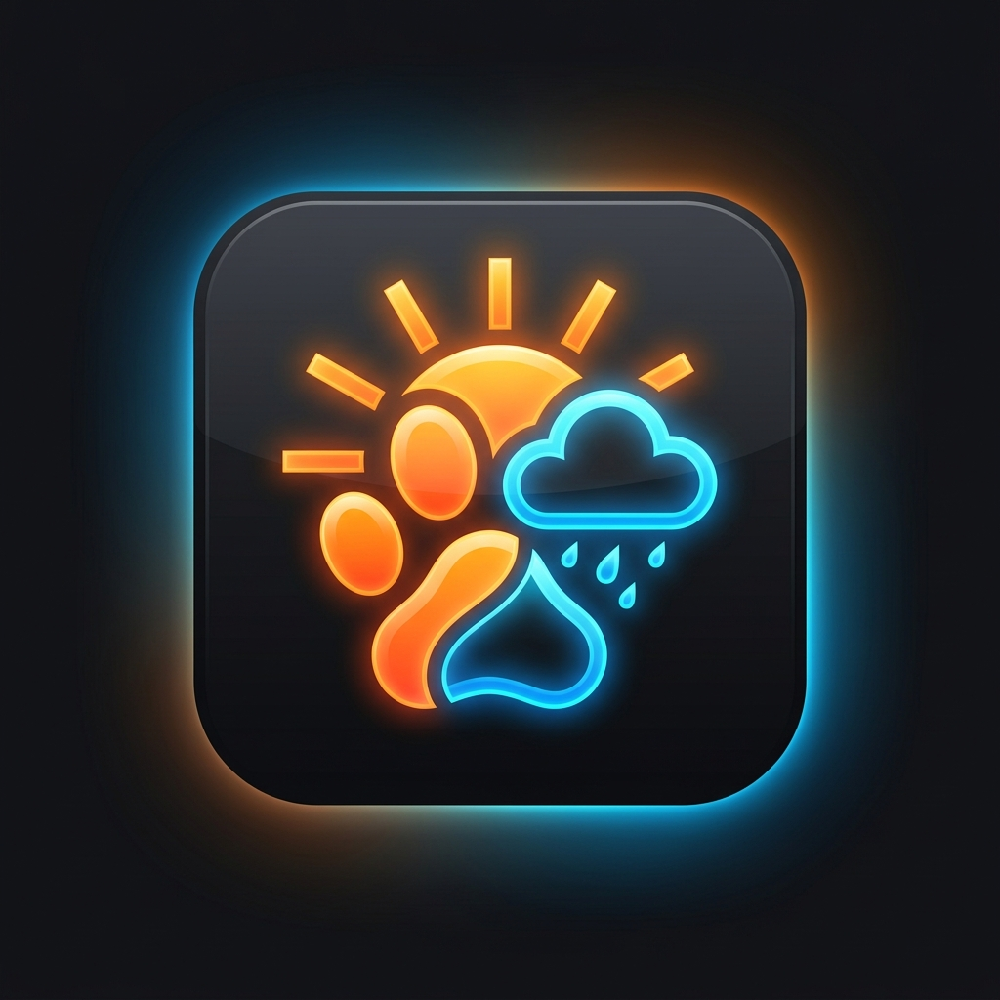

# PawCast — Local Weather, Live Radar, Air Quality & Dog Walk Field Station



**PawCast** (Rev 5.0) is a zero-build, client-side meteorological field station, live Doppler precipitation radar, EPA air quality & aeroallergen monitor, and canine walk/pavement safety guide. Styled after classic industrial instruments from Dieter Rams (Braun), Teenage Engineering, and NOAA field hardware, it pairs everyday local weather forecasting with physics-informed outdoor and dog-walking safety guidance.

---

## Key Capabilities

- **Current Weather Hero & Atmospheric Summary** — Live temperature, daily high/low, sky condition, geographic coordinates, dynamic day/night illustrated backdrops, feels-like temperature, humidity & dew point, wind & gusts, sunrise/sunset times, and a one-click real-time allergy/AQI status bar.
- **Thermodynamic Pavement & Dog Walk Check** — Estimates sun-baked asphalt and lawn surface temperatures from ambient air temperature, UV solar irradiance, day/night state, and wind cooling, flagging freeze/road-salt hazards (`< 32°F`), warm blacktop (`≥ 105°F`), and paw-burn danger (`≥ 125°F`).
- **Multi-Dog Pack Roster & Personalized Thresholds** — Maintain multiple dog profiles (size, coat type, brachycephalic/flat-faced snout, pollen sensitivity, and age group) with instant one-click switching in the sub-header, automatic `localStorage` persistence, and JSON backup export.
- **Rolling 7-Day Weather, Pollen & Walk Almanac** — Guaranteed 7-day daily outlook displaying high/low temperatures, rain probability, peak wind, daily dominant allergen/pollen tier, and personalized walk status badges, paired with a **Best Hours Outdoors Today** recommendation strip.
- **24-Hour Horizon SVG Chart & Scroller** — Custom cubic-Bézier temperature curve with precipitation probability bars, color-coded safety data nodes, and horizontally scrollable hourly forecast cards.
- **Live Doppler Precipitation Radar** — Interactive Leaflet map on Esri World Dark Gray cartography overlaying RainViewer past and nowcast radar frames (zoom levels 3–7) with animated playback and frame timestamps.
- **4-Channel Pollen Spectrum, EPA AQI & Field Manual** — Tracks Grass, Tree, Ragweed/Weed, and Fungal Mold indices (`0–10` scale) alongside US EPA AQI, `PM2.5`, `PM10`, and ground-level Ozone (`O₃`), complete with hover popovers and an expandable, filterable 8-card **Allergen Guide**.
- **Procedural Web Audio Soundscape** — Zero external audio assets; synthesizes real-time rain, wind-speed-modulated breeze, daytime songbirds, evening crickets, radar sonar pings, and tactile hardware switch clicks via the browser Web Audio API.
- **Dual Forecast Engines & Timestamp Auto-Polling** — Switch between **Open-Meteo Global Forecast** and **NOAA National Weather Service (US)** (automatically enriched to a full 7-day almanac), backed by a drift-proof countdown timer (`5`, `10`, `15`, or `30` minutes) that recovers cleanly when background tabs regain focus.

---

## Quick Start

PawCast is a pure HTML5, CSS3, and vanilla ES6+ JavaScript web application with **no build step, bundler, or API keys required**.

### Option 1: Local Static Server (Recommended)

Serving over `http://localhost` ensures smooth geolocation permissions and external API requests:

```bash
# Clone the repository
git clone https://github.com/XayerMorgan/pawcast.git
cd pawcast

# Start any static file server (Python 3 example)
python3 -m http.server 8000
```

Then open `http://localhost:8000` in any modern browser.

### Option 2: Direct File Open

You can also open `index.html` directly in Chrome, Firefox, Safari, or Edge (`file://`), though browser GPS geolocation works most reliably over `localhost` or `https://`.

---

## Documentation & Help Files

- **[User Guide & Field Manual (`HELP.md`)](HELP.md)** — Complete instructions for searching locations, configuring options, calibrating multi-dog profiles, interpreting pavement thermal scales, operating the Doppler radar, and reading pollen/AQI metrics.
- **[Project Facts & Technical Reference (`docs/PROJECT_FACTS.md`)](docs/PROJECT_FACTS.md)** — Detailed architecture breakdown, thermodynamic & aeroallergen formulas, safety thresholds, external API endpoints, `localStorage` schema, and design system tokens.

---

## Data Sources & Technology Stack

All live telemetry is fetched directly in the browser from free, keyless public APIs:

| Domain | Provider / Technology | Usage |
| :--- | :--- | :--- |
| **Global Weather** | [Open-Meteo Forecast API](https://open-meteo.com/) | Current observations, 24-hour horizon, solar/UV data, and 7-day daily forecast |
| **US Official Weather** | [NOAA National Weather Service API](https://www.weather.gov/documentation/services-web-api) | US point & hourly forecasts (`api.weather.gov`) plus direct `Weather.gov` dispatch links |
| **Air Quality & Pollen** | [Open-Meteo Air Quality API (CAMS)](https://open-meteo.com/en/docs/air-quality-api) | US EPA AQI, `PM2.5`, `PM10`, Ozone (`O₃`), and multi-species pollen hourly forecasts |
| **Geocoding** | [Open-Meteo Geocoding API](https://open-meteo.com/en/docs/geocoding-api) | Global city and postal-code search autocomplete |
| **Live Doppler Radar** | [RainViewer Weather Maps API](https://www.rainviewer.com/api.html) | Past & nowcast precipitation radar tiles (Zoom 3–7) |
| **Base Map Tiles** | [Leaflet 1.9.4](https://leafletjs.com/) + Esri ArcGIS | `World_Dark_Gray_Base` & `World_Dark_Gray_Reference` map layers |
| **Typography & Audio** | Google Fonts + Web Audio API | `Fraunces`, `Plus Jakarta Sans`, `JetBrains Mono`, and procedural Web Audio synthesis |

---

## Repository Layout

```text
pawcast/
├── index.html               # Application markup, ARIA landmarks, modals & allergen reference drawer
├── styles.css               # Braun/NOAA industrial design system, themes & responsive grid
├── app.js                   # Telemetry fetchers, safety/pollen models, SVG chart, radar & Web Audio engine
├── pawcast_logo.png         # Application icon and brand emblem
├── field_station_day.jpg    # Hero weather card daytime backdrop illustration
├── field_station_night.jpg  # Hero weather card nighttime backdrop illustration
├── HELP.md                  # End-user help guide, controls walkthrough & FAQ
└── docs/
    └── PROJECT_FACTS.md     # Technical specification, algorithms, APIs & state schema
```

---

## Privacy & Disclaimer

- **Local-First Privacy:** Saved cities, active preferences, and dog profiles are stored strictly in your browser's `localStorage`. No accounts, analytics trackers, or third-party cookies are used.
- **Informational Use Only:** Pavement temperatures, heat comfort ratings, pollen indices, and canine care notes are mathematical estimates intended for general outdoor planning and are **not** veterinary or medical advice. Always test sun-exposed pavement directly (the 7-second bare-hand rule) and consult a licensed veterinarian or physician for health decisions.
